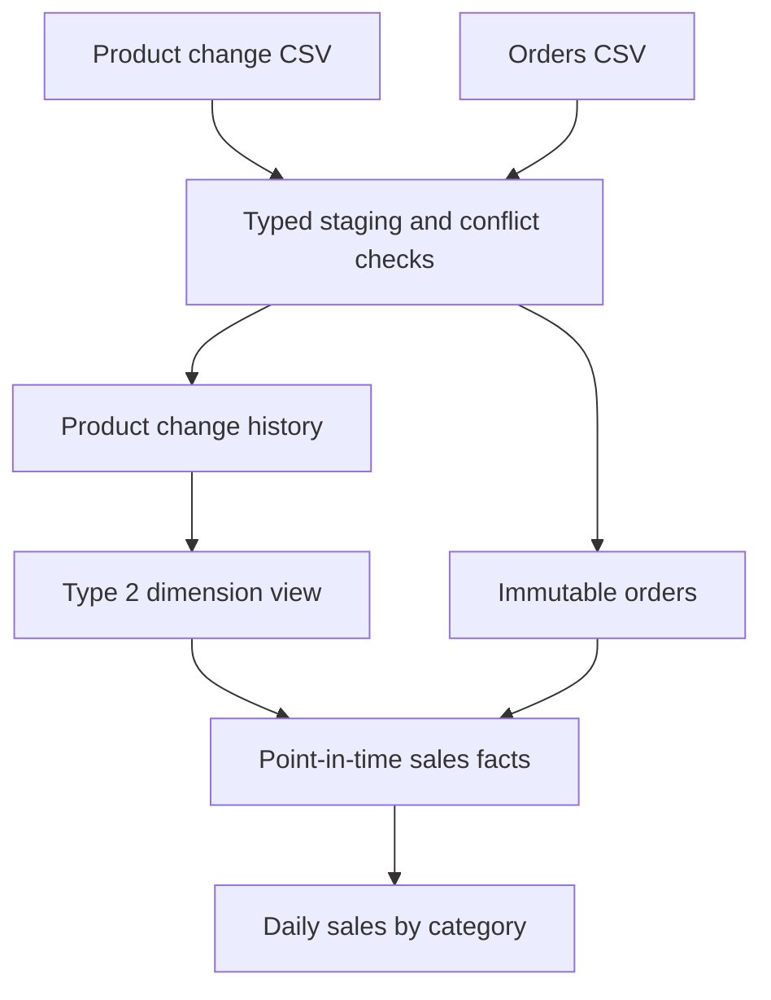

# Incremental Retail Warehouse

Build a retail sales warehouse with an effective-dated product dimension. The demo shows how to update reporting when a product category change arrives after related sales have already loaded.



## Run the demo

1. Install Python 3.10 or newer, clone the repository and open a terminal at its root.
2. Create a virtual environment and install DuckDB. On Windows PowerShell, activate with `.\.venv\Scripts\Activate.ps1`.

   ```sh
   python -m venv .venv
   . .venv/bin/activate
   python -m pip install -r requirements.txt
   ```

3. Load the initial batch into a fresh database.

   ```sh
   python pipeline.py data/products_01.csv data/orders_01.csv
   ```

   Expect two orders in Beverages, on January 2 and January 4.
4. Apply the second batch, then run it again to verify replay.

   ```sh
   python pipeline.py data/products_02.csv data/orders_02.csv
   ```

   Expect the January 2 sale to remain in Beverages and the January 4 and 5 sales to appear under Energy Drinks. There should be three total orders and 1,650 cents of revenue on both runs.
5. Run the regression test.

   ```sh
   python -m unittest discover -s tests -v
   ```

## Design and recovery

Order ID is the fact key. Product ID and effective date identify each dimension change. SQL uses `lead` to derive half-open validity intervals. The fact view joins each order to the matching product version using its order date. When a late product version arrives, the view resolves both past and new orders against the corrected timeline.

Exact replays are deduplicated. Conflicting immutable records or orders without effective product coverage roll back the entire input batch. Resolve the input, then rerun with the same database. Use `--db` to create a separate demo database. The local design favors clarity and reprocesses the relevant view at query time. For an AWS deployment, AWS Glue could stage files from S3 and Redshift could materialize the affected facts and dates after a load. The repository implements the DuckDB version with synthetic data.
